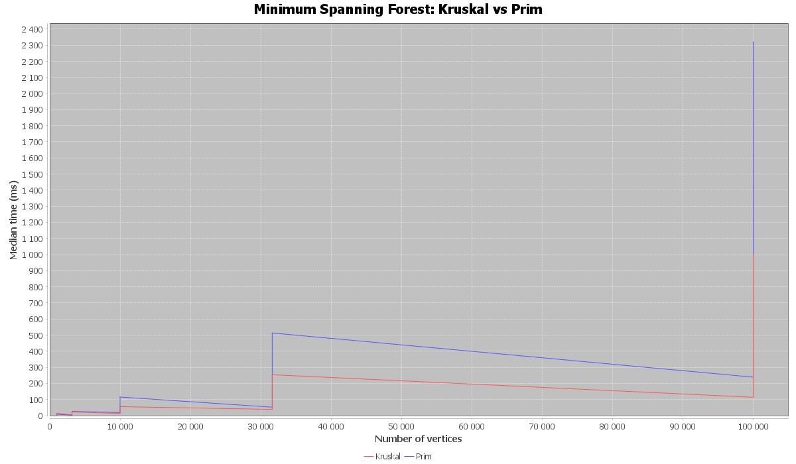
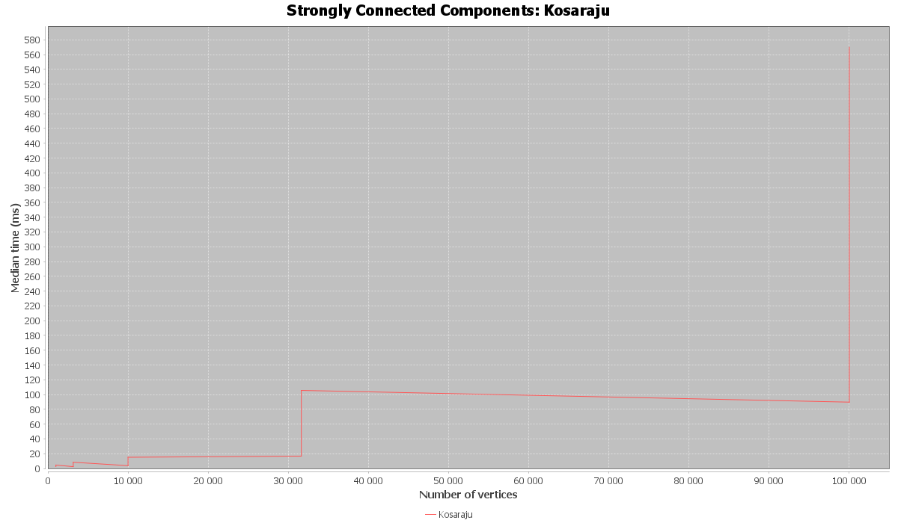
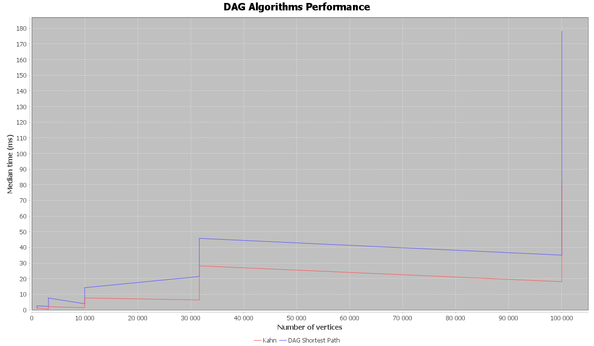

# DAA Assignment 3 — Graph Algorithms and Performance Analysis

## 1. Introduction

The purpose of this assignment is to implement, test, and analyze graph algorithms using Java. The project focuses on minimum spanning trees, strongly connected components, topological sorting, and shortest paths in directed acyclic graphs (DAGs).

The project also includes a graph generator, automated tests, performance measurements, CSV output, and graphical visualization of benchmark results.

## 2. Technologies Used

- Java 17
- Apache Maven
- JUnit 5.12.2
- JFreeChart 1.5.6
- CSV for storing benchmark results
- Git and GitHub for version control

## 3. Implemented Algorithms

### 3.1. Kruskal's Algorithm

Kruskal's algorithm finds a minimum spanning tree (MST) of a connected, undirected, weighted graph.

The algorithm sorts edges by weight and adds an edge if it does not create a cycle. A Disjoint Set Union (DSU) data structure is used to manage connected components.

**Time complexity:** O(E log E), where E is the number of edges.

**Applications:** Network design, infrastructure planning, and connecting locations at minimum total cost.

### 3.2. Prim's Algorithm

Prim's algorithm also finds a minimum spanning tree. It starts from a vertex and repeatedly adds the minimum-weight edge connecting the current tree to a new vertex.

**Time complexity:** O(E log V) with a suitable priority queue and adjacency-list representation.

**Applications:** Network construction, cable routing, and infrastructure optimization.

Kruskal's and Prim's algorithms should produce the same minimum total spanning-tree weight for the same connected, undirected, weighted graph.

### 3.3. Kosaraju's Algorithm

Kosaraju's algorithm identifies strongly connected components (SCCs) in a directed graph.

It uses two depth-first search passes. The first pass determines vertex finishing order. The graph is then reversed, and the second pass identifies the strongly connected components.

**Time complexity:** O(V + E).

**Applications:** Dependency analysis, directed network analysis, and identifying mutually reachable vertices.

### 3.4. Kahn's Algorithm

Kahn's algorithm finds a topological ordering of a directed graph by repeatedly removing vertices with in-degree zero.

A topological ordering exists only if the directed graph is acyclic (a DAG). If not all vertices can be processed, the graph contains a cycle.

**Time complexity:** O(V + E).

**Applications:** Task scheduling, dependency resolution, and build systems.

### 3.5. Shortest Paths in a DAG

The DAG shortest-path algorithm computes shortest distances from a source vertex in a directed acyclic graph. It processes vertices in topological order and relaxes their outgoing edges.

Unlike Dijkstra's algorithm, this method supports negative edge weights as long as the graph is acyclic.

**Time complexity:** O(V + E).

**Applications:** Scheduling, dependency networks, and optimization problems represented by acyclic graphs.

## 4. Graph Generation and Benchmark Methodology

The project includes a graph generator for creating undirected graphs, directed graphs, and directed acyclic graphs.

A fixed random seed is used to make graph generation reproducible. Generated graphs are used to evaluate algorithm behavior across different input sizes and edge densities.

The benchmark records execution time and algorithm-related metrics in `results/benchmark.csv`.

The CSV output includes:

- Algorithm name
- Graph type
- Number of vertices (V)
- Number of edges (E)
- Execution time in milliseconds
- DSU operations
- Edge scans
- Comparisons
- Maximum recorded depth
- Algorithm result

Execution time can vary with the hardware, Java runtime, and system load. Therefore, benchmark results should be interpreted in the context of the environment in which they were collected.

## 5. Complexity Summary

| Algorithm | Purpose | Time Complexity |
|---|---|---|
| Kruskal | Minimum spanning tree | O(E log E) |
| Prim | Minimum spanning tree | O(E log V) with a priority queue and adjacency lists |
| Kosaraju | Strongly connected components | O(V + E) |
| Kahn | Topological ordering | O(V + E) |
| DAG Shortest Path | Shortest paths in a DAG | O(V + E) |

Here, V denotes the number of vertices and E denotes the number of edges.

## 6. Benchmark Visualization

The benchmark results are visualized using JFreeChart. The generated images are stored in `results/plots/`.

### 6.1. Minimum Spanning Tree Comparison



This chart compares the measured execution times of Kruskal's and Prim's algorithms on undirected weighted graphs.

The comparison helps evaluate how the algorithms behave as graph size and edge density increase. Both algorithms should return the same minimum spanning-tree weight when run on the same connected graph.

### 6.2. Strongly Connected Components



This chart presents the measured performance of Kosaraju's algorithm on directed graphs.

Its theoretical time complexity is O(V + E), so its work is expected to grow approximately with the combined number of vertices and edges, subject to implementation and runtime overhead.

### 6.3. DAG Algorithms



This chart presents the benchmark results for Kahn's topological sorting algorithm and the DAG shortest-path algorithm.

Both algorithms have linear time complexity, O(V + E), with appropriate graph representations. Their measured execution times can differ because they perform different operations and have different implementation overhead.

## 7. Correctness Testing

Automated tests are included using JUnit 5.

The tests cover important cases such as:

- Minimum spanning-tree weights and connected components
- Negative edge weights in minimum spanning-tree algorithms
- Strongly connected components
- Valid topological orderings and cycle detection
- Shortest paths with negative edges in DAGs
- Unreachable vertices
- Empty graphs and single-vertex graphs, where supported
- Invalid graph types and invalid input parameters
- Reproducible graph generation

Correctness is evaluated separately from performance. An algorithm should produce a valid result before its benchmark measurements are used for comparison.

## 8. Discussion

The algorithms solve different graph problems and should be compared according to their purpose.

Kruskal's and Prim's algorithms find minimum spanning trees. Kosaraju's algorithm identifies strongly connected components. Kahn's algorithm produces a topological ordering, and the DAG shortest-path algorithm calculates shortest distances in an acyclic directed graph.

The theoretical complexities help explain expected scaling behavior, while the benchmark measurements show how the implementations perform on the generated inputs.

The actual measured results in `benchmark.csv` should be used to support any conclusions about which implementation is faster for a particular graph size or density. Small differences in execution time may be influenced by JVM warm-up, garbage collection, hardware, and system load.

## 9. Conclusion

This project demonstrates the implementation and testing of five fundamental graph algorithms in Java. It combines graph generation, algorithm correctness tests, performance measurement, CSV data collection, and graphical visualization.

The assignment illustrates the importance of selecting an algorithm based on the graph problem, understanding its theoretical complexity, and validating its behavior through automated tests and reproducible experiments.

## 10. Reproducibility

To run the automated tests:

```bash
mvn test
```

To generate benchmark results, run the `com.daa.benchmark.Benchmark` class.

To create the charts, run the `com.daa.benchmark.GraphPlotter` class after the benchmark CSV file has been generated.

The benchmark data is stored in `results/benchmark.csv`, and the chart images are stored in `results/plots/`.
